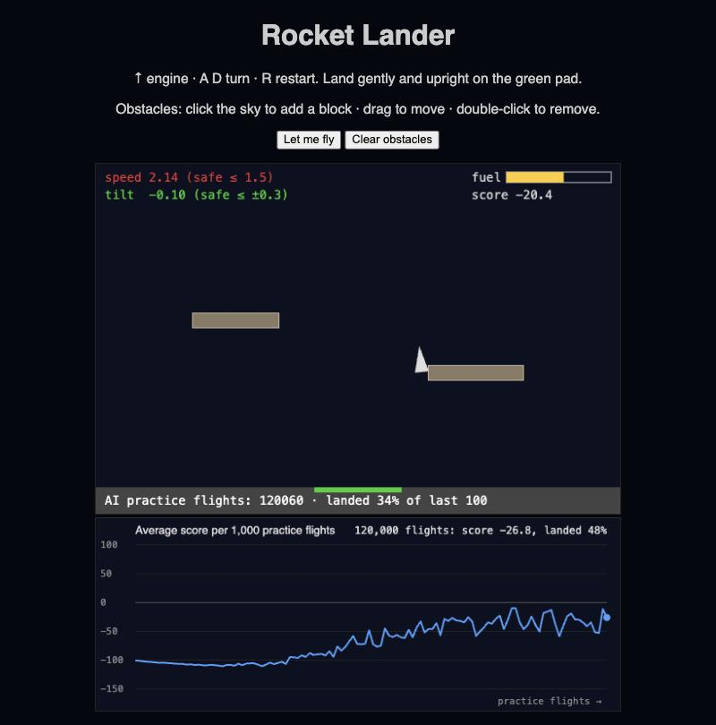

# Rocket Lander: an AI that learns to land a rocket

A rocket that teaches itself to land using **reinforcement learning**, trained live in your browser. No libraries, no server, no installation: just plain JavaScript.



Click **Let the AI learn** and watch it go from crashing every time to landing about half its flights in under a minute. The chart shows its average score climbing as it learns.

## Try it

**Live demo: https://kezed007.github.io/rocket-lander/** (opens in your browser, nothing to install)

Or run it on your own computer:

```bash
python3 -m http.server 8000 --bind 127.0.0.1
```

(`--bind 127.0.0.1` keeps the server visible only to your own computer, not to everyone on your Wi‑Fi.)

Then open http://localhost:8000.

- **Fly it yourself:** ↑ engine, A and D turn, R restart. Land gently and upright on the green pad.
- **Obstacles:** click the sky to add a block, drag to move it, double-click to remove it (works with a finger on phones). Hitting a block is a crash. You can rearrange them while the AI is learning.
- **Let the AI learn:** it practises about 1,200 flights per second in the background. The rocket on screen shows what it has learned so far.
- **Settings:** sliders change gravity, thrust, fuel, the rewards and how much the AI explores, live. **Reset AI** wipes its memory so you can watch it learn a new world from scratch.

## How it works

| File | What it does |
|------|--------------|
| [`physics.js`](physics.js) | The world: gravity, engine thrust, rotation, fuel, obstacles, and landing or crash detection. One function, `step(rocket, action)`, moves time forward one frame. |
| [`agent.js`](agent.js) | The AI: tabular **Q-learning**. |
| [`game.js`](game.js) | Draws the world, reads the keyboard and mouse, and runs the training loop. |
| [`chart.js`](chart.js) | The live learning curve, drawn on a canvas. |
| [`settings.js`](settings.js) | The slider panel. |
| [`test.js`](test.js) | Automated checks for the physics and the AI. |

### Rewards

The AI is never told what "landing" means. It only gets a score:

- **+100** for touching down slowly and upright on the pad
- **−100** for crashing or flying off screen
- **−0.3** for every frame the engine burns fuel

### Q-learning

The AI keeps a table of guesses: for each situation, *how much total score will each action lead to?*

1. **See:** round the rocket's position, speed, tilt and fuel into a situation, such as "left of pad, high, falling fast, upright". It also "sees" the nearest block underneath it, if any: how close, and whether dodging left or right is shorter.
2. **Act:** usually pick the action with the best guess, but 10% of the time try a random one (exploration).
3. **Learn:** after seeing the reward and the next situation, nudge the guess:

   `guess += 0.1 × (reward + 0.99 × best guess for next situation − guess)`

After tens of thousands of practice flights, "pick the best guess" turns into "land the rocket".

### Why the AI needs "eyes"

An AI can only avoid what it can observe. With a block that never moves, the AI could get by just memorising "crashes happen around here". But when a block moves, that memory is wrong. Describing the block *relative to the rocket* fixes this. In an offline test where the block moved to a random spot every flight, the AI with eyes landed 24–50% of flights after 100,000 practice runs, while the blind version landed only 5–11%.

## Experiments to try

- **Exploration:** set AI explore chance to 0, then press Reset AI. With no random actions it often gets stuck with a bad habit.
- **Bad rewards:** set fuel cost to −5. Burning fuel now costs more than crashing, so the AI learns to crash on purpose.
- **Transfer:** let it learn, then raise gravity to 0.09. Does it adapt faster than starting fresh with Reset AI?
- **Obstacles:** let it learn, then drag a block right above the pad. Watch the chart dip, then recover as it learns a way around.

## Tests

```bash
node test.js
```

Checks gravity, thrust, fuel, obstacles, landing and crash rules, the rewards, the AI's view of blocks, and that the AI lands more than 15% of flights after 100,000 practice flights (it usually reaches 40–70%).

## Ideas for next steps

- Add a "getting closer to the pad" reward to speed up learning (reward shaping)
- Swap the table for a small neural network (Deep Q-Network) so it can handle exact numbers instead of buckets
- Add wind, or a moving landing pad
